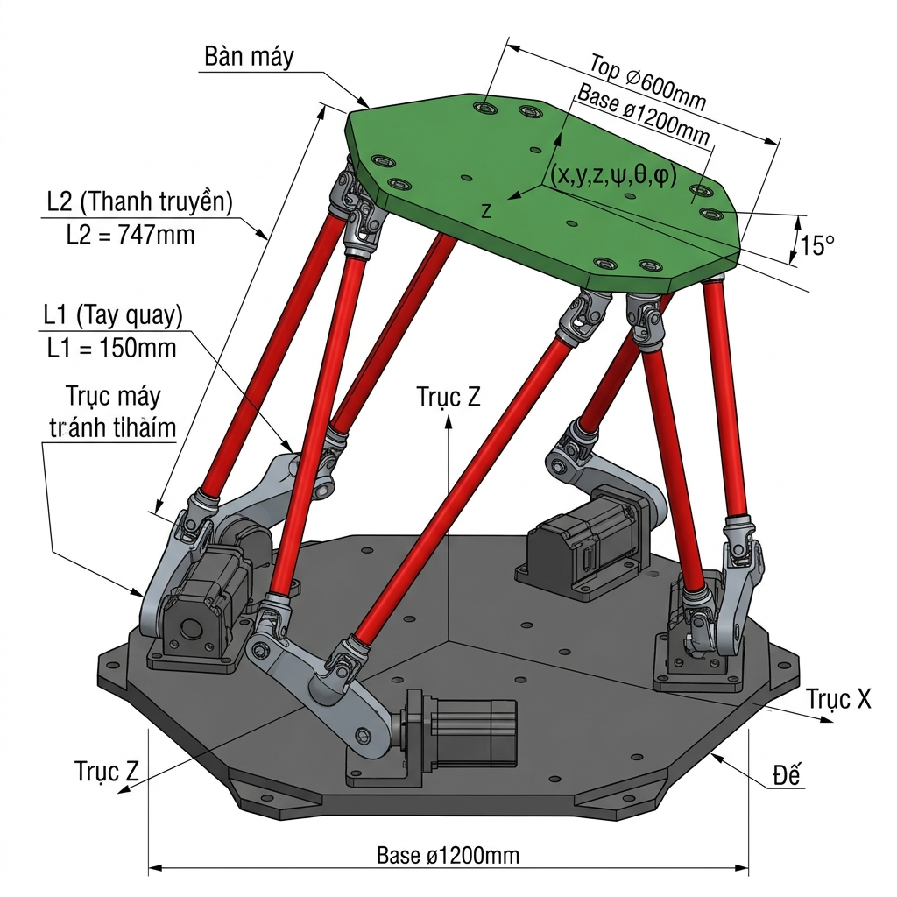

<h1 align="center">🤖 6-DOF Stewart Platform Digital Twin — CKAS W2</h1>

<p align="center">
  <b>TÀI LIỆU KỸ THUẬT BÀN GIAO ĐỒ ÁN TỐT NGHIỆP</b><br>
  Thiết kế cấu hình cơ khí và xây dựng chương trình mô phỏng hệ mô phỏng lái CKAS W2 6 bậc tự do<br>
  <i>(Tất cả thông số và quy trình được đối chiếu và xác minh chuẩn xác theo đồ án tốt nghiệp ĐATN_NQTS.pdf)</i>
</p>

<p align="center">
  
</p>

---

## 📌 Mục lục

- [1. Giới thiệu tổng quan hệ thống](#1-giới-thiệu-tổng-quan-hệ-thống)
- [2. Thông số kỹ thuật & Cấu hình cơ khí chuẩn](#2-thông-số-kỹ-thuật--cấu-hình-cơ-khí-chuẩn)
- [3. Quy trình chuyển đổi CAD từ SolidWorks sang Matlab Simulink](#3-quy-trình-chuyển-đổi-cad-từ-solidworks-sang-matlab-simulink)
- [4. Cơ sở toán học & Bài toán động học](#4-cơ-sở-toán-học--bài-toán-động-học)
  - [4.1. Động học ngược (Inverse Kinematics)](#41-động-học-ngược-inverse-kinematics)
  - [4.2. Động học thuận (Forward Kinematics - Newton Raphson)](#42-động-học-thuận-forward-kinematics---newton-raphson)
  - [4.3. Kiểm tra không gian hoạt động & 3 lớp an toàn](#43-kiểm-tra-không-gian-hoạt-động--3-lớp-an-toàn)
- [5. Chương trình mô phỏng & Giao diện Dashboard](#5-chương-trình-mô-phỏng--giao-diện-dashboard)
- [6. Định dạng dữ liệu lệnh chuyển động (M-Code)](#6-định-dạng-dữ-liệu-lệnh-chuyển-động-m-code)
- [7. Thí nghiệm thực tế xác định tâm quay ảo (Pivot Point)](#7-thí-nghiệm-thực-tế-xác-định-tâm-quay-ảo-pivot-point)
- [8. Catalogue toàn bộ file mã nguồn](#8-catalogue-toàn-bộ-file-mã-nguồn)
- [9. Sơ đồ liên kết các Function](#9-sơ-đồ-liên-kết-các-function)
- [10. Cấu trúc phân nhánh (Branches) trên GitHub](#10-cấu-trúc-phân-nhánh-branches-trên-github)

---

## 1. Giới thiệu tổng quan hệ thống

Hệ thống mô phỏng lái **CKAS W2 6-DOF** là nền tảng bệ động cơ học (Motion Platform) tiêu chuẩn công nghiệp được ứng dụng trong mô phỏng lái xe và huấn luyện thực tế ảo.

- **Dạng cơ cấu động học:** Gough-Stewart Platform cấu hình **6-RUS** (Revolute – Universal – Spherical) với cấu trúc phân bố hình học dạng **bán 3-3** (3 cặp động cơ ở đế và 3 cặp khớp cầu ở bàn máy).
- **Cấu tạo 3 thành phần chính:**
  1. **Bệ cố định (Base):** Khung đế chịu lực neo cứng xuống sàn, bố trí 6 động cơ servo chia thành 3 cặp đối xứng.
  2. **Bệ động (Top Platform):** Khung sàn phía trên lắp ghế ngồi, cabin lái; mặt dưới bố trí 6 khớp cầu chia thành 3 cặp.
  3. **Cụm 6 chân truyền động:** Mỗi chân gồm cánh tay quay ngắn $L_1$ gắn trục động cơ, liên kết qua chốt và khớp chữ Y (Universal Joint) với thanh truyền dài $L_2$, đầu trên gắn vào khớp cầu (Spherical Joint).
- **Mục tiêu của chương trình mô phỏng:** Kiểm chứng quỹ đạo chuyển động, đánh giá tính an toàn (tránh kịch hành trình, quá tải góc và tránh rơi vào điểm kỳ dị) trước khi gửi lệnh thực thi trên phần cứng CKAS W2 thật.

---

## 2. Thông số kỹ thuật & Cấu hình cơ khí chuẩn

### 2.1. Giới hạn chuyển động của CKAS W2 *(Bảng 1-1, ĐATN)*

| Trục chuyển động | Dịch chuyển cho phép | Vận tốc cực đại | Gia tốc cực đại |
|---|---|---|---|
| **Surge ($X$)** | $\pm 150\text{ mm}$ | $\pm 300\text{ mm/s}$ | $\pm 0.5\text{ G}$ |
| **Sway ($Y$)** | $\pm 150\text{ mm}$ | $\pm 300\text{ mm/s}$ | $\pm 0.5\text{ G}$ |
| **Heave ($Z$)** | $\pm 150\text{ mm}$ | $\pm 300\text{ mm/s}$ | $\pm 0.5\text{ G}$ |
| **Roll ($\phi$)** | $\pm 23^\circ$ | $\pm 40^\circ/\text{s}$ | $\pm 500^\circ/\text{s}^2$ |
| **Pitch ($\theta$)** | $\pm 22^\circ$ | $\pm 40^\circ/\text{s}$ | $\pm 500^\circ/\text{s}^2$ |
| **Yaw ($\psi$)** | $\pm 25^\circ$ | $\pm 40^\circ/\text{s}$ | $\pm 500^\circ/\text{s}^2$ |

*Tải trọng danh định:* Khối lượng tải $200\text{ kg}$, Moment quán tính tải giới hạn $100\text{ kg}\cdot\text{m}^2$.

### 2.2. Kích thước hình học cơ cấu *(Bảng 3-1, ĐATN)*

| Tham số | Giá trị | Đơn vị | Định nghĩa kỹ thuật trong đồ án |
|---|---|---|---|
| $r_a$ | **589.66** | mm | Bán kính đường tròn ngoại tiếp đi qua tâm của 6 trục động cơ dưới bệ đế ($A_1 \dots A_6$) |
| $r_b$ | **429.57** (429.566) | mm | Bán kính đường tròn ngoại tiếp đi qua 6 khớp cầu tại mặt dưới bàn máy ($B_1 \dots B_6$) |
| $L_1$ | **150** | mm | Chiều dài cánh tay quay động cơ (tay ngắn) |
| $L_2$ | **747** | mm | Chiều dài thanh truyền dẫn động (tay dài) |
| $\alpha_1$ | **19.45** | độ | Góc lắp đặt của động cơ 1 ($A_1$) hợp với trục $OX$ của bệ đế |
| $\Delta\alpha$ ($\delta_a$) | **38.9** | độ | Khoảng cách góc giữa hai động cơ trong cùng một cặp ($OA_1$ và $OA_2$) |
| $\beta_1$ | **53.32** | độ | Góc định vị khớp cầu 1 ($B_1$) hợp với trục $OX$ của bệ động |
| $\Delta\beta$ ($\delta_b$) | **13.37** (10.0) | độ | Góc kẹp giữa hai khớp cầu liền kề trong cùng một cặp ($OB_2$ và $OB_3$) |
| $z_A$ ($Z_{\text{home}}$) | **592.4** (hoặc 795.4) | mm | Độ cao của tâm bệ động ở vị trí trung hòa (Neutral Position) |
| $\gamma_i$ | $\alpha_i + ((-1)^i) \cdot 90^\circ$ | độ | Góc trục quay của động cơ thứ $i$ |

---

## 3. Quy trình chuyển đổi CAD từ SolidWorks sang Matlab Simulink

*(Trích xuất chính xác theo Mục 4.1, Trang 60–63 của đồ án ĐATN_NQTS.pdf)*

Để mô hình 3D từ SolidWorks có thể hoạt động chính xác và nhẹ tải trong Simscape Multibody, quy trình chuẩn hóa bao gồm các bước:

```
  ┌────────────────────────────────────────────────────────┐
  │ 1. Thiết kế 3D trên SOLIDWORKS                          │
  │    (Gán đầy đủ khớp Rotational Joint và Spherical Joint)│
  └──────────────────────────┬─────────────────────────────┘
                             │
                             ▼
  ┌────────────────────────────────────────────────────────┐
  │ 2. Tinh chỉnh & Tối giản hóa sơ đồ khối:               │
  │    - Loại bỏ các ràng buộc Mate tĩnh (bu lông, đai ốc) │
  │    - Mở từng Sub-assembly -> File -> Save As           │
  │    - Chọn Save as copy and continue                    │
  │    - Chọn định dạng Part (*.prt, *.sldprt) vào CÙNG 1  │
  │      thư mục làm việc                                  │
  │    - Lắp ráp lại thành file SolidAssembly tổng thể mới │
  └──────────────────────────┬─────────────────────────────┘
                             │
                             ▼
  ┌────────────────────────────────────────────────────────┐
  │ 3. Xuất file .xml bằng Simscape Multibody Link:        │
  │    - SolidWorks: Options -> Add-Ins                    │
  │    - Tích chọn "Simscape Multibody Link" -> OK         │
  │    - Vào Tools -> Simscape Multibody Link -> Export -> │
  │      Simscape Multibody...                             │
  │    - Thu được tệp cấu trúc .xml và các file part hình  │
  │      học đi kèm (*.STEP)                               │
  └──────────────────────────┬─────────────────────────────┘
                             │
                             ▼
  ┌────────────────────────────────────────────────────────┐
  │ 4. Nhập vào MATLAB Simulink:                           │
  │    - Mở MATLAB Command Window, gõ lệnh:                │
  │         >> smimport('Tên_file.xml')                    │
  │    - MATLAB tự động tạo mô hình sơ đồ khối Simulink    │
  │      (World Frame, Transform, Revolute, Spherical...)  │
  │    - Trích xuất tín hiệu đo: Bật Sensing trong khối   │
  └────────────────────────────────────────────────────────┘
```

> **Ghi chú quan trọng:** Lệnh `smimport` trong MATLAB **chỉ nhận tệp đầu vào là `.xml`** do SolidWorks Simscape Multibody Link xuất ra. Các tệp `.STEP` trong thư mục là tệp hình học phụ trợ được Simscape đọc thông qua file chỉ mục `.xml`, **không thể dùng lệnh `smimport` trực tiếp trên file `.STEP`**.

---

## 4. Cơ sở toán học & Bài toán động học

*(Trích xuất theo Chương 3, Trang 35–44 của đồ án ĐATN_NQTS.pdf)*

### 4.1. Động học ngược (Inverse Kinematics)

Mục đích: Từ tư thế yêu cầu của bệ động $P = [x, y, z, \text{roll } \phi, \text{pitch } \theta, \text{yaw } \psi]^T$, tính ra góc quay $\delta_i$ (hoặc $\phi_i$) của 6 động cơ servo.

1. **Ma trận quay ZYX:**
   $$R = R_z(\psi) R_y(\theta) R_x(\phi)$$

2. **Tọa độ khớp cầu bệ động trong hệ cố định:**
   $$B_i = T + R \cdot b_i$$

3. **Vector chân ảo:**
   $$\vec{L}_i = B_i - A_i = [L_{ix}, L_{iy}, L_{iz}]^T$$
   $$d_i = \|\vec{L}_i\| = \sqrt{L_{ix}^2 + L_{iy}^2 + L_{iz}^2}$$

4. **Phương trình vòng khép kín:**
   $$\|B_i - C_i\|^2 = L_2^2 \iff Q_i = M_i \sin\phi_{raw,i} + N_i \cos\phi_{raw,i}$$
   Trong đó:
   - $Q_i = d_i^2 - L_2^2 + L_1^2$
   - $M_i = 2 L_1 L_{iz}$
   - $N_i = 2 L_1 (L_{ix}\cos\gamma_i + L_{iy}\sin\gamma_i)$

5. **Nghiệm góc động cơ:**
   $$\phi_{raw,i} = \arcsin\left(\frac{Q_i}{\sqrt{M_i^2 + N_i^2}}\right) - \text{atan2}(N_i, M_i)$$

6. **Bù góc offset servo thực tế:**
   Quy đổi sang góc thực $\phi_{thuc}$ theo quy ước driver phần cứng CKAS W2:
   $$\begin{cases}
   \phi_{step}(1:2:5) = -(90^\circ + \phi_{raw}(1:2:5)) \\
   \phi_{step}(2:2:6) = +(90^\circ + \phi_{raw}(2:2:6))
   \end{cases}$$
   $$\phi_{thuc} = \phi_{step} - [90^\circ, -90^\circ, 90^\circ, -90^\circ, 90^\circ, -90^\circ]$$
   $$\phi_{thuc}(1:2:5) = -\phi_{thuc}(1:2:5)$$

### 4.2. Động học thuận (Forward Kinematics - Newton Raphson)

Tìm vector vị trí bệ động $X = [x, y, z, \phi, \theta, \psi]^T$ khi biết trước 6 góc quay mục tiêu $\phi_{target}$:
$$F(X) = \text{IK}(X) - \phi_{target} = 0$$

Lặp theo công thức:
$$X_{k+1} = X_k - J^\dagger(X_k) \cdot F(X_k)$$
- Dừng khi sai số lớn nhất $\max |\Delta\phi| < 10^{-6}$ độ.

### 4.3. Kiểm tra không gian hoạt động & 3 lớp an toàn

*(Mục 3.3 trang 42–44 & Bước 3 trang 62 của đồ án)*

Trước khi cho cơ cấu chuyển động, quỹ đạo bắt buộc phải vượt qua **3 lớp gác cổng**:

1. **Lớp 1 — Giới hạn kích thước vật lý (Tầm với):**
   $$\left|\frac{Q_i}{\sqrt{M_i^2 + N_i^2}}\right| \le 1$$
   Nếu $|arg| > 1$, điểm yêu cầu vượt quá chiều dài sải tay của cơ cấu, hàm IK trả về `NaN`.
2. **Lớp 2 — Giới hạn góc quay động cơ:**
   $$\phi_{min} \le \phi_i \le \phi_{max} \quad (\text{mặc định: } -50^\circ \le \phi_i \le 90^\circ)$$
   Ngăn chặn cánh tay quay $L_1$ va đập vào khung bệ đế hoặc vượt ngưỡng hành trình servo.
3. **Lớp 3 — Giới hạn điểm kỳ dị (Singularity):**
   $$\left|\det(J)\right| > 10^{-3}$$
   Tính định thức của ma trận Jacobian vận tốc $J$. Nếu $\det(J) \to 0$, cơ cấu rơi vào cấu hình kỳ dị mất bậc tự do, lực dọc trục tăng vọt gây nguy cơ cong gãy thanh truyền.

---

## 5. Chương trình mô phỏng & Giao diện Dashboard

*(Chương 4, Trang 56–64 của đồ án ĐATN_NQTS.pdf)*

Chương trình giao diện chính **`Dashboard_Stewart5.m`** (phát triển hoàn thiện từ `dashboard_stewart3.m` trong đồ án) tích hợp đầy đủ quy trình 5 bước:

- **Bước 1: Nhập cấu hình cơ khí:** Cho phép nhập $r_a, r_b, L_1, L_2, \alpha_1, \beta_1, \delta_a, \delta_b$, HomeZ. Hỗ trợ **Lưu cấu hình (.mat)** và **Import cấu hình (.mat)**.
- **Bước 2: Cập nhật cấu hình:** Vẽ mô hình 3D tĩnh, tính tọa độ ma trận điểm $A$, điểm $B$, góc $\gamma$ và đồng bộ biến sang Simulink Workspace.
- **Bước 3: Thiết lập Quỹ đạo:**
  - *Lựa chọn A - Import file quỹ đạo:* Hỗ trợ file `.csv` hoặc `.txt` theo chuẩn M-Code của CKAS.
  - *Lựa chọn B - Sinh quỹ đạo mẫu:* Tịnh tiến Heave Z, quay Roll, quay Pitch, đường tròn XY, cua chữ S; lựa chọn tâm quay (Tâm bệ động, Đỉnh đầu người lái, hoặc Tọa độ bất kỳ).
- **Bước 4: Kiểm định an toàn & Chạy mô phỏng:** Tự động chạy qua 3 lớp an toàn. Nếu đạt, kích hoạt chạy mô phỏng 3D trên GUI đồng thời gọi mô hình Simulink (`Final_CKASForSIM30_11_SIM.slx`) để đối chiếu nghiệm số.
- **Bước 5: Export dữ liệu & Vẽ đồ thị:** Xuất file kết quả 15 tham số, vẽ các đồ thị chuyển động động học, động lực học và biểu đồ góc quay động cơ.

---

## 6. Định dạng dữ liệu lệnh chuyển động (M-Code)

*(Bảng 4-2, Trang 62 và Mục 1.4.4, Trang 10–11 của đồ án)*

Lệnh chuyển động bệ động tuân thủ cấu trúc lệnh công nghiệp của CKAS W2:

### Cú pháp tổng quát:
```text
~M[<x> <y> <z> <yaw> <pitch> <roll> [<axi> <ayi> <azi> <axg> <ayg> <azg> <wz> <wy> <wx>]]
```

| Tham số | Kiểu | Đơn vị | Ý nghĩa kỹ thuật |
|---|---|---|---|
| `<x>`, `<y>`, `<z>` | Float | mm | Tọa độ tịnh tiến bệ động so với vị trí trung hòa (Tiến, Phải, Xuống) |
| `<yaw>`, `<pitch>`, `<roll>` | Float | độ | Góc xoay Euler theo thứ tự Z - Y - X |
| `<axi>`, `<ayi>`, `<azi>` | Float | m/s² | Gia tốc quán tính trong hệ trục bệ động (không gồm trọng lực) |
| `<axg>`, `<ayg>`, `<azg>` | Float | m/s² | Hình chiếu gia tốc trọng trường trên hệ bệ động |
| `<wz>`, `<wy>`, `<wx>` | Float | rad/s | Vận tốc góc theo các trục yaw, pitch, roll |

- **File 7 tham số:** Chứa $[t, x, y, z, \text{roll}, \text{pitch}, \text{yaw}]$ phục vụ bài toán động học.
- **File 15 tham số:** Bổ sung vận tốc góc và gia tốc dài phục vụ tính toán động lực học quán tính.

---

## 7. Thí nghiệm thực tế xác định tâm quay ảo (Pivot Point)

*(Chương 5, Trang 67–84 của đồ án ĐATN_NQTS.pdf)*

Để giải quyết bài toán bù gia tốc quán tính lên đầu phi công, vị trí tâm quay ảo $P$ được xác định thông qua thực nghiệm với cảm biến IMU:

1. **Phương pháp đo lường độc lập:**
   - Thực hiện chuyển động quay thuần Pitch quanh trục $Y$ để xác định tọa độ khoảng cách $(r_x, r_z)$.
   - Thực hiện chuyển động quay thuần Roll quanh trục $X$ để xác định tọa độ khoảng cách $(r_y, r_z)$.
2. **Xử lý tín hiệu thực nghiệm:**
   - **Lọc nhiễu tần số cao:** Phân tích phổ FFT và áp dụng bộ lọc thông thấp (LPF) để làm mượt tín hiệu gia tốc và vận tốc góc.
   - **Hiệu chỉnh sai số gá đặt:** Sử dụng thuật toán Phân tích thành phần chính (PCA) để xoay hệ trục tọa độ của cảm biến IMU về song song hoàn toàn với hệ tọa độ bàn máy, triệt tiêu hiện tượng rò rỉ kênh tín hiệu (crosstalk).

---

## 8. Catalogue toàn bộ file mã nguồn

| Tên file | Phân loại | Input | Output | Chức năng chi tiết theo ĐATN |
|---|---|---|---|---|
| [`calc_Geometry.m`](calc_Geometry.m) | Hình học | $r_a, r_b, \alpha_1, \beta_1, \delta_a, \delta_b$ | `A_mat, B_mat, gamma_ang` | Tính tọa độ 3D của 6 khớp đế, 6 khớp bàn và góc $\gamma$ gá động cơ *(Bảng 3-1)* |
| [`donghocnguoc_final1.m`](donghocnguoc_final1.m) | IK Core | `pose`, hình học | `phi_out` [1×6] | Giải động học ngược ra góc servo thực tế có bù offset; trả về `NaN` nếu quá tầm với |
| [`donghocthuan_NR.m`](donghocthuan_NR.m) | FK Core | `phi_target`, `pose_guess`, hình học | `pose_out, iter, err` | Giải động học thuận bằng thuật toán Newton-Raphson |
| [`check_pose_safety.m`](check_pose_safety.m) | An toàn | `pose`, hình học | `is_safe, error_msg, phi_out` | Cổng kiểm tra 3 lớp an toàn: tầm với cơ học, góc quay servo, kỳ dị ma trận |
| [`jacobian_RUS.m`](jacobian_RUS.m) | Vận tốc | `pose, pose_dot`, hình học | `J, theta_dot` | Ma trận Jacobian liên kết vận tốc Cartesian và vận tốc góc tay quay |
| [`tinh_torque.m`](tinh_torque.m) | Động lực học | `pose, pose_dot, pose_ddot`, khối lượng | `tau_motor, F_joint, f_rod` | Tính toán moment động cơ servo và lực kéo/nén trong thanh truyền |
| [`tinh_vel.m`](tinh_vel.m) | Vận tốc | `pose, vel`, hình học | `motor_vel_rpm, J_v, phi_thuc` | Tính tốc độ quay của 6 động cơ theo đơn vị vòng/phút (RPM) |
| [`Final_CKASForSIM30_11_SIM.slx`](Final_CKASForSIM30_11_SIM.slx) | Mô phỏng | Góc 6 servo `phi(t)` | Tọa độ bệ động 3D, moment | Mô hình vật lý Simscape Multibody được tạo từ `smimport` file CAD |
| [`Dashboard_Stewart5.m`](Dashboard_Stewart5.m) | Giao diện | Người dùng thao tác | 3D animation, đồ thị | Trung tâm điều khiển và giám sát mô phỏng tích hợp 5 bước của đồ án |
| [`Trajectory_Generator.m`](Trajectory_Generator.m) | Sinh quỹ đạo | Biên độ, tần số, pivot | File CSV quỹ đạo | Công cụ tạo quỹ đạo mẫu (Heave, Pitch, Roll, Circle XY, S-curve) |
| [`sim.py`](sim.py) | Python 3D | File CSV M-Code | Cửa sổ 3D VisPy | Bộ mô phỏng 3D độc lập bằng Python hỗ trợ kiểm tra nhanh quỹ đạo |

---

## 9. Sơ đồ liên kết các Function

```text
                             ┌──────────────────────┐
                             │  Dashboard_Stewart5  │
                             │ (Giao diện chính GUI)│
                             └──────────┬───────────┘
                                        │
                         ┌──────────────┴──────────────┐
                         ▼                             ▼
              ┌─────────────────────┐       ┌──────────────────────┐
              │    calc_Geometry    │       │ Trajectory_Generator │
              │ ra,rb,α,β,da,db     │       │ (Sinh quỹ đạo mẫu)   │
              └──────────┬──────────┘       └──────────┬───────────┘
                         │                             │
                         │ [A_mat, B_mat, gamma_ang]   │ pose [x,y,z,R,P,Y]
                         ▼                             ▼
              ┌───────────────────────────────────────────────┐
              │               check_pose_safety               │
              │  (Kiểm tra 3 lớp: Tầm với -> Góc -> Kỳ dị)    │
              └──────┬────────────────────────────────┬───────┘
                     │ Gọi IK                         │ Gọi định thức J
                     ▼                                ▼
       ┌───────────────────────────┐     ┌────────────────────────────┐
       │   donghocnguoc_final1     │     │  kiem_tra_ki_di_optimized  │
       │   (Giải góc servo thực)   │     │  (det(J) > 1e-3)           │
       └─────────────┬─────────────┘     └────────────────────────────┘
                     │ phi_out
                     ├───────────────────────────────┐
                     ▼                               ▼
       ┌───────────────────────────┐   ┌──────────────────────────────┐
       │     donghocthuan_NR       │   │         tinh_torque          │
       │  (Newton-Raphson FK)      │   │  (Moment động cơ & lực rod)  │
       └───────────────────────────┘   └─────────────┬────────────────┘
                                                     │
                                                     ▼
                                       ┌──────────────────────────────┐
                                       │ Final_CKASForSIM30_11_SIM.slx│
                                       │ (Simscape Multibody Model)   │
                                       └──────────────────────────────┘
```

---

## 10. Cấu trúc phân nhánh (Branches) trên GitHub

Repository được phân chia thành **4 nhánh chuyên đề** song song với nhánh `main`:

| Nhánh | Thư mục & Tài liệu tương ứng | Nội dung kỹ thuật bàn giao |
|---|---|---|
| `main` | `README.md` (tài liệu này) | Tổng quan hệ thống, catalogue I/O, báo cáo ĐATN |
| **`feature/inverse-kinematics`** | `kinematics/README.md`, `kinematics/USAGE.md` | Thuật toán IK, FK Newton-Raphson, phân tích Workspace |
| **`feature/dynamics`** | `dynamics/README.md`, `dynamics/USAGE.md` | Tính moment $\tau$, mô hình Simscape Multibody, kiểm thử lực |
| **`feature/data`** | `data/README.md`, `data/USAGE.md` | Bộ file M-Code 7/15 tham số, dữ liệu thực nghiệm IMU, ảnh phân tích |
| **`feature/cad`** | `cad/README.md`, `cad/USAGE.md` | Bản vẽ 3D STEP, BOM chi tiết cơ khí, quy trình xuất `.xml` từ SolidWorks |
